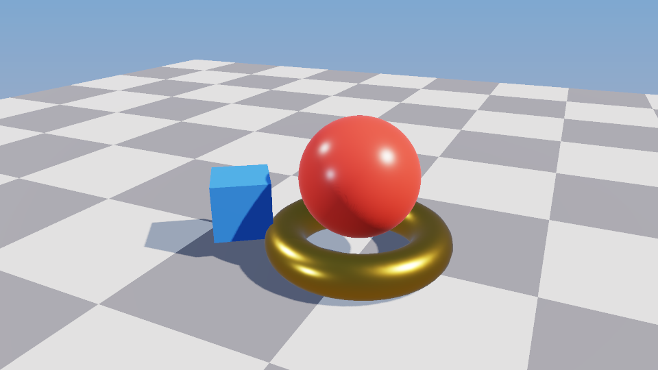
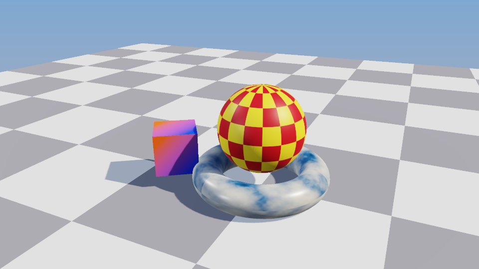
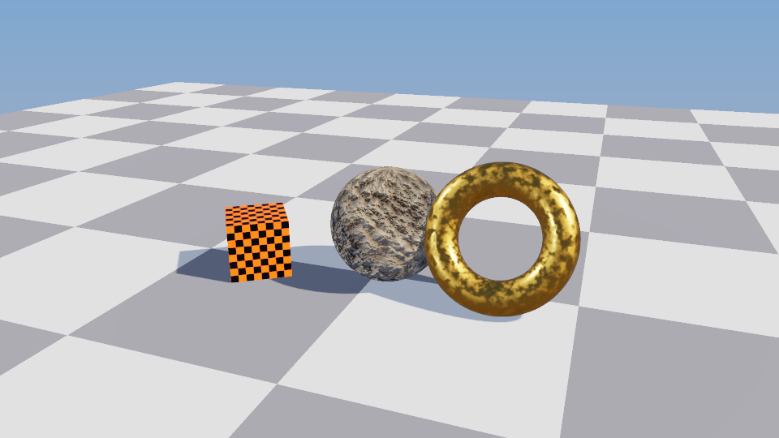
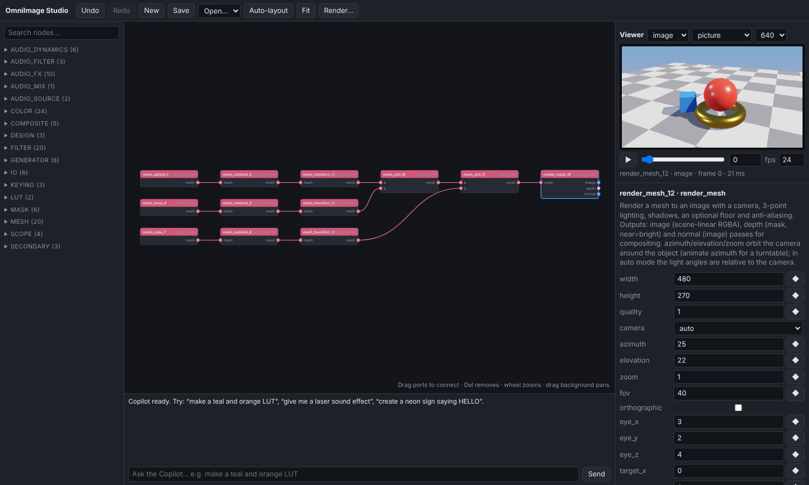
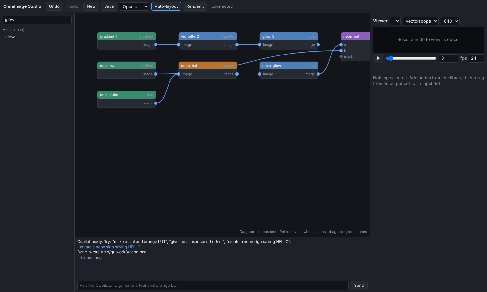
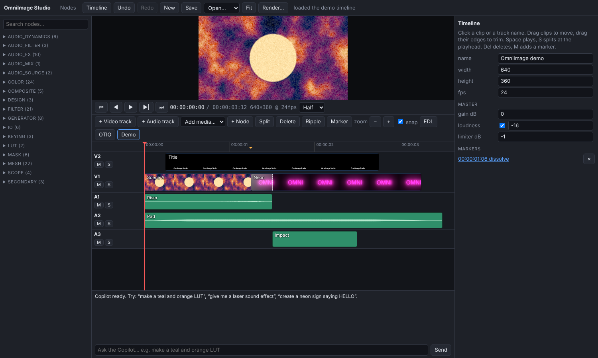

# OmniImage Studio

**An open-source, node-based media engine for images, video, audio, VFX, SFX and LUTs, with a built-in AI Media Copilot.**
Think of the node graphs of Blender/Resolve/Nuke as a plain Python library and CLI that you can script, test, and extend.

<p align="center">
  <a href="https://github.com/YOUR_USERNAME/omniimage-studio/releases/latest"></a>
  <a href="https://github.com/YOUR_USERNAME/omniimage-studio/archive/refs/heads/main.zip"></a>
</p>
<p align="center">
  <a href="https://github.com/YOUR_USERNAME/omniimage-studio/actions/workflows/ci.yml"></a>
  
  
</p>

**Get started in two commands** (Python 3.10+; install [ffmpeg](https://ffmpeg.org/download.html) for video and most audio formats):

```bash
pip install https://github.com/YOUR_USERNAME/omniimage-studio/archive/refs/heads/main.zip
omni gui        # opens the node editor and timeline at http://127.0.0.1:8765
```

> **Status: v0.8 alpha. Engine + local web GUI with a timeline workspace + a 3D layer (meshes, UVs, PBR texture maps, glTF, renderer). No 3D animation rigs yet.** It is real and tested (459 tests), but it covers a small slice of the long-term vision in [`docs/Media_Studio_Feature_Blueprint.docx`](docs/Media_Studio_Feature_Blueprint.docx). See [ROADMAP.md](ROADMAP.md).

## 3D (v0.5; textures and glTF v0.6; PBR maps v0.7)

Meshes are a first-class node type (pink wires), so 3D flows into the same compositing, colour and scope nodes as everything else.







- **Primitives:** cube, plane, UV sphere, icosphere, cylinder, cone, torus (all but the icosphere come with UVs); load/save `.obj` (with UVs), `.stl`, and **glTF 2.0** (`.glb` / `.gltf` in, `.glb` out).
- **Modifiers:** transform (animatable), material (colour, roughness, metallic, emission), Loop subdivision, Laplacian smooth, noise displace (animatable), twist, array, mirror, join, flat/smooth shading.
- **PBR maps (v0.7):** `mesh_texture` also takes `normal`, `roughness`, `metallic`, `emissive` and `occlusion` images. The renderer does tangent-space normal mapping (glTF convention: +Y is image-up), multiplies roughness/metallic/emissive per pixel and darkens ambient light with the occlusion map, all mip-mapped. `normal_from_height` turns any height map (a noise node, a painted image) into a normal map. Load map files with `load_image decode=linear` so they are treated as data, not colour.
- **UVs and textures (v0.6):** `mesh_uv_project` (planar / cylindrical / spherical / box) and `mesh_texture` (paint any image node onto a mesh; tile and offset; mip-mapped trilinear filtering, seam-safe). Subdivision, smoothing and displacement keep UVs and seams intact.
- **glTF:** reads node hierarchies, strip/fan/indexed triangles, strided and normalised accessors, `COLOR_0`, metallic-roughness factors, emissive (+ `KHR_materials_emissive_strength`), and all five maps: base colour, normal, metallic-roughness, emissive, occlusion (+ `KHR_texture_transform` scale/offset). Writes one `.glb` with per-material primitives and embedded PNG maps. Refuses sparse accessors and Draco/meshopt files with a clear message; external files must live inside the model's folder.
- **Renderer** (`render_mesh`, pure NumPy): perspective/orthographic camera with orbit controls (animate `azimuth` for a turntable), GGX specular + diffuse + sky lighting, key/fill/rim lights, soft shadow-mapped key light, checker/plane floor, anti-aliasing, wireframe, ACES tone map. Extra **depth** and **normal** passes feed 2D nodes.
- **CLI:** `omni mesh make torus -o t.obj`, `omni mesh info t.obj`, `omni mesh render t.obj -o t.png --floor`. Copilot: "render a gold 3D torus".
- **Limits:** CPU only (about 1 s for a few thousand triangles; tens of thousands get slow). Textures always repeat (no clamp or mirror), and every map of one material shares one UV set and transform. No skins, morph targets or animation import, no FBX, and no boolean ops, sculpting, rigging, or physics. See ROADMAP.



## GUI (v0.4; timeline workspace v0.8)

```bash
omni gui                       # opens http://127.0.0.1:8765 : node editor, timeline, viewer, inspector, Copilot
omni gui project.json --backend openai --base-url http://localhost:11434/v1 --model qwen2.5:7b
```



**Timeline workspace (v0.8).** The *Timeline* tab is a multitrack editor on top of the existing timeline engine:



- Tracks and clips with filmstrip thumbnails and audio waveforms (gain and fades included), a ruler with markers, a playhead you can scrub, zoom (buttons or Ctrl+wheel) and snapping to clip edges, markers and the playhead.
- Drag a clip to move it (also to another track of the same kind), drag its edges to trim, **S** to split at the playhead, **Del** to delete, **Shift+Del** to ripple-delete, **M** for a marker, **Space** to play (frames follow the sound), arrows to step, Ctrl+Z / Ctrl+Y for undo and redo. Every change is validated on the server and one undo step.
- Place files from the work folder, or send the node selected in the node editor to the timeline as a clip (its upstream graph is copied, so later edits to the node graph do not change the clip).
- The inspector edits the clip (start, duration, speed, opacity or a fade, fit), the transition into it (dissolve, dip to black, wipes), its effects (one-click picture effects added to the clip's own graph, with every parameter editable), the track (mute, solo, opacity, blend, gain, pan, bus) and the timeline (size, fps, master loudness and limiter, markers).
- Preview renders at draft, half or full resolution; *Render…* writes video or an image sequence, and *EDL* / *OTIO* export for other editors. Timelines save as `*.timeline.json`.

Node library with search, drag-to-wire typed ports, per-node inspector (sliders/colour/choice, keyframe button, `=expression`), a viewer with waveform / RGB parade / vectorscope / histogram, frame scrubber and playback, undo/redo (Ctrl+Z), save/open, render to video or image sequence, and the Copilot chat (each request is one undo step). It is a local, dependency-free server bound to 127.0.0.1 with a per-session token, Host check and a work-folder sandbox. Not yet in the GUI: a 3D viewport, vector canvas, keyframe curves on the timeline, and multi-user collaboration. Limits of the timeline workspace: placed files keep their absolute path inside the saved timeline (move the work folder and re-place them), source frames play 1:1 (use *speed* to retime), audio preview is capped at 5 minutes and *Render…* at 2000 frames per request (use `omni timeline` for longer).

## What works today

- **129 nodes** (generators, colour, filters, compositing, keying, image I/O incl. EXR/16-bit, audio synthesis and DSP, plus the Phase 1 additions below), typed ports, cycle/type checking, lazy cached evaluation. Reference: [`docs/NODE_REFERENCE.md`](docs/NODE_REFERENCE.md).
- **Animation**: keyframes (linear/smooth/hold) and safe expressions (`=sin(t*6)*0.5`) on any numeric parameter.
- **LUTs**: read/write `.cube`, apply with intensity, and **bake any colour-only node graph into a 3D LUT**. 14 built-in looks (teal-orange, bleach bypass, noir, vintage fade, ...).
- **Colour management** (new in 0.2): `colorspace` node converts between sRGB, Rec.709, Rec.2020, P3-D65, ACEScg, ACEScct, ARRI LogC3/AWG3 and Sony S-Log3/S-Gamut3 (Bradford-adapted, checked against published reference values), and it bakes into LUTs like any colour node.
- **Scopes** (new): waveform, RGB parade, vectorscope, histogram as nodes.
- **Secondary grading** (new): HSL qualifier, power windows (ellipse/rect/rounded, rotation, soft edge), gradient windows; feed the mask to `merge`.
- **Design layer** (new, Figma-style): anti-aliased vector shapes (rect, rounded rect, ellipse, polygon, star, line) with gradients and inside/centre/outside strokes, drop shadow, and auto-layout stacks.
- **Timeline and editing** (new in 0.3): video/audio tracks of clips (from files or any node graph), in-points, speed, animated opacity, fit modes, blend modes, dissolve / dip-to-black / wipe transitions, markers, JSON save/load, render to video.
- **Audio mixer** (new): per-track gain automation, pan, mute/solo, buses, sidechain ducking, soft limiter, **EBU R128 / BS.1770 loudness** measurement and target-LUFS mastering (checked against the EBU reference values).
- **Interchange** (new): export CMX3600 **EDL** and **OpenTimelineIO** (validated by loading with the real `opentimelineio` library) for Resolve/Premiere/Blender.
- **VFX presets**: VHS, film, dreamy, glitch, toon, hologram, heat haze, neon sign, green-screen composite.
- **SFX**: whoosh, laser, explosion, coin, riser, impact, wind, all synthesised from node graphs (no samples, no licence worries).
- **AI Media Copilot** (`src/omniimage/ai_assistant.py`): describe what you want; it builds the node graph, renders previews and exports LUTs/SFX. Works **offline** with built-in rules, or with any OpenAI-compatible local model (Ollama, llama.cpp, vLLM, LM Studio). Sandboxed to a work folder; each request is one undo step.
- **Rendering**: image sequences, and H.264/AAC (VP9/Opus) video through ffmpeg, with audio.
- **Plugins**: drop a `.py` in `~/.omniimage/plugins` or ship an `omniimage.nodes` entry point.

## Install

```bash
pip install -e .            # Python >= 3.10
# optional: ffmpeg on PATH for video; pip install -e ".[exr]" for compressed EXR
```

## Try it in 30 seconds

```bash
omni demo --quick -o demo_out     # look contact sheet, .cube LUTs, SFX wavs, effects sheet, a short mp4
omni lut make teal_orange -o teal_orange.cube
omni lut apply photo.jpg teal_orange.cube -o graded.png
omni sfx make laser -o laser.wav
omni fx apply vhs photo.jpg -o vhs.png
omni copilot "make a sepia LUT" --workdir out
omni timeline demo -o t.json && omni timeline info t.json && omni timeline render t.json -o cut.mp4
omni timeline export t.json --format otio -o cut.otio     # or --format edl
```

## Python

```python
import omniimage as o
from omniimage.lut import bake_lut

g = o.Graph()
src = g.add("lut_input", id="src")
g.chain(src, g.add("srgb_to_linear"), g.add("exposure", stops=0.4),
        g.add("saturation", amount=1.3), g.add("linear_to_srgb", id="out"))
bake_lut(g, "out", "src", size=33).write_cube("mine.cube")      # a node graph becomes a LUT
```

Animated parameters:

```python
g.add("glow", radius=20, intensity={"keys": [[0, 0], [24, 2]], "interp": "smooth"})
g.add("exposure", stops="=sin(t*6.28)*0.5")
```

## Copilot with a local LLM

```bash
ollama pull qwen2.5:7b
omni copilot --backend openai --base-url http://localhost:11434/v1 --model qwen2.5:7b --workdir out \
  "make a cold moody LUT and a short riser sound effect"
```

The model gets tools (`add_node`, `connect`, `set_param`, `apply_effect`, `bake_lut`, `render_preview`, ...) and can only write inside `--workdir`. Quality depends on the model you choose; tool-calling models work best.

## Limits (read this)

- The timeline workspace edits clips, transitions, effects and audio levels, but has no keyframe curve editor, nested/compound clips, slip/slide/roll trims or multicam yet, and the Copilot does not drive it yet. Playback is a proxy preview (frames fetched from a CPU renderer), not real-time at full resolution. CPU only (NumPy/OpenCV).
- LUT baking works only for colour-only graphs; blur/grain etc. are refused by design.
- OpenColorIO, ONNX AI nodes (upscale, segmentation, Whisper, Demucs) are roadmap items, not included.
- The OpenAI-compatible backend is tested against a mock server, not against every model.
- Offline Copilot understands a fixed set of intents; free-form requests need an LLM backend.

## Development

```bash
pip install -e ".[dev]" && pytest -q   # tests/test_gui_browser.py drives the GUI in a real browser and skips itself without Playwright + Chrome
```

License: Apache-2.0. Third-party notes: [THIRD_PARTY.md](THIRD_PARTY.md). Contributions: [CONTRIBUTING.md](CONTRIBUTING.md).
